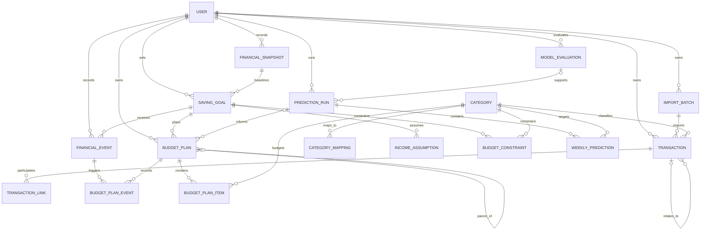

# 数据库设计

## 1. 数据库与命名约定

- V1 数据库：SQLite。
- 数据访问：SQLAlchemy 2.x；结构迁移：Alembic。
- 主键：应用内部整数主键；API 可使用不暴露顺序的公共 ID 映射，阶段 3 不实现。
- 表名和字段名：英文复数表名、`snake_case` 字段。
- 时间戳：UTC；业务周期使用本地日期。
- 金额：`INTEGER/BIGINT` 最小货币单位，字段后缀 `_minor`。
- 百分比/权重：整数基点，字段后缀 `_bps`，0—10000。
- 删除策略：财务事实和计划版本默认软停用或保留，不级联删除历史；私有源文件按独立策略删除。

数据库不保存原始账单文件完整路径、完整账号、银行卡号、真实交易对象和详细备注。

## 2. 核心表

### 2.1 users

基础用户，不设计 OAuth、RBAC 或企业组织。

| 字段 | 类型 | 约束/说明 |
| --- | --- | --- |
| id | integer | PK |
| username | varchar(64) | unique，基础登录名 |
| password_hash | varchar(255) | 可空；未启用登录时不使用 |
| timezone | varchar(64) | 默认 `Asia/Shanghai` |
| is_active | boolean | 默认 true |
| created_at / updated_at | datetime UTC | 必填 |

### 2.2 import_batches

| 字段 | 类型 | 约束/说明 |
| --- | --- | --- |
| id | integer | PK |
| user_id | FK users | 必填 |
| source | varchar(24) | wechat/alipay/bank |
| file_format | varchar(16) | xlsx/csv 等 |
| file_fingerprint | char(64) | 文件 SHA-256；索引，不是路径 |
| source_timezone | varchar(64) | 默认用户时区 |
| parser_name / parser_version | varchar | 必填 |
| raw_count | integer | >= 0 |
| success_count | integer | >= 0 |
| failed_count | integer | >= 0 |
| duplicate_count | integer | >= 0 |
| cross_source_candidate_count | integer | >= 0 |
| period_start_utc / period_end_utc | datetime | 可空 |
| status | varchar(24) | pending/running/completed/partial/failed/duplicate_file |
| error_summary_json | text/json | 仅错误代码和计数，不含隐私明细 |
| created_at / started_at / completed_at | datetime UTC | 运行时间 |

同一文件指纹可保留多次“导入尝试”历史，因此不设唯一约束；服务层默认拒绝重复文件，显式重试需要记录原因。

### 2.3 categories

| 字段 | 类型 | 约束/说明 |
| --- | --- | --- |
| id | integer | PK |
| code | varchar(40) | unique，稳定英文代码 |
| name | varchar(40) | 中文显示名 |
| scope | varchar(16) | V1 为 expense |
| sort_order | integer | 显示顺序 |
| is_active | boolean | 默认 true |

V1 种子类别：餐饮、购物、交通、居住与缴费、医疗健康、教育、通讯与数字服务、娱乐、人情往来、其他消费。

### 2.4 category_mappings

| 字段 | 类型 | 约束/说明 |
| --- | --- | --- |
| id | integer | PK |
| source | varchar(24) | 来源平台 |
| source_type_code | varchar(80) | 已脱敏的来源类型代码 |
| category_id | FK categories | 目标类别 |
| priority | integer | 数值越小优先级越高 |
| mapping_version | varchar(40) | 规则版本 |
| is_active | boolean | 默认 true |
| created_at | datetime UTC | 必填 |

唯一约束：`(source, source_type_code, mapping_version)`。

### 2.5 transactions

| 字段 | 类型 | 约束/说明 |
| --- | --- | --- |
| id | integer | PK |
| user_id | FK users | 必填 |
| import_batch_id | FK import_batches | 必填 |
| source | varchar(24) | 冗余来源用于高频过滤；与批次一致 |
| source_record_fingerprint | char(64) | HMAC，不保存原交易号 |
| occurred_at_utc | datetime UTC | 必填 |
| amount_minor | bigint/integer | >= 0 |
| currency | char(3) | 默认 CNY |
| direction | varchar(16) | inflow/outflow/neutral |
| flow_type | varchar(32) | consumption/income/income_candidate/expense_refund/transfer/internal_transfer/balance_transfer/red_packet/other |
| normalized_status | varchar(24) | completed/refunded/partial_refund/reversed/pending/failed/unknown |
| source_type_code | varchar(80) | 通用短代码 |
| original_category | varchar(80) | 可空，仅保存非敏感稳定来源类别 |
| suggested_category_id | FK categories | 可空 |
| user_category_id | FK categories | 可空，优先于自动类别 |
| classification_version | varchar(40) | 可空 |
| classification_confidence_bps | integer | 可空，0—10000 |
| related_transaction_id | self FK | 可空，退款关联 |
| canonical_transaction_id | self FK | 可空，确认重复后指向保留记录 |
| counterparty_fingerprint | char(64) | 可空 HMAC |
| source_account_fingerprint | char(64) | 可空 HMAC |
| is_abnormal | boolean | 默认 false |
| created_at | datetime UTC | 必填 |

唯一约束：`(user_id, source, source_record_fingerprint)`。

检查约束：金额非负；分类置信度在 0—10000；自身不能指向自身的关联/规范记录。

### 2.6 transaction_links

保存尚未确认或已确认的跨源重复、内部转账和退款匹配。

| 字段 | 类型 | 约束/说明 |
| --- | --- | --- |
| id | integer | PK |
| user_id | FK users | 必填 |
| transaction_a_id / transaction_b_id | FK transactions | 必填，A < B 规范化 |
| link_type | varchar(32) | duplicate/internal_transfer/refund |
| confidence_bps | integer | 0—10000 |
| resolution_status | varchar(16) | pending/confirmed/rejected |
| evidence_codes_json | text/json | 仅特征代码，如 same_amount，不存原备注 |
| resolved_at | datetime UTC | 可空 |
| created_at | datetime UTC | 必填 |

唯一约束：`(transaction_a_id, transaction_b_id, link_type)`。

### 2.7 financial_snapshots

| 字段 | 类型 | 约束/说明 |
| --- | --- | --- |
| id | integer | PK |
| user_id | FK users | 必填 |
| as_of_date | date | 用户本地日期 |
| available_savings_minor | bigint/integer | 可为 0，不允许负数 |
| currency | char(3) | 默认 CNY |
| source | varchar(16) | user_input/imported/derived |
| created_at | datetime UTC | 必填 |

当前存款不直接反复覆盖到目标中；目标和预算计划引用所使用的快照。

### 2.8 saving_goals

| 字段 | 类型 | 约束/说明 |
| --- | --- | --- |
| id | integer | PK |
| user_id | FK users | 必填 |
| baseline_snapshot_id | FK financial_snapshots | 必填 |
| start_date | date | 必填 |
| target_date | date | 必须晚于 start_date |
| target_savings_minor | bigint/integer | > 0 |
| currency | char(3) | 默认 CNY |
| status | varchar(16) | active/achieved/cancelled/expired |
| version | integer | >= 1，修改目标时递增 |
| created_at / updated_at | datetime UTC | 必填 |

目标变更由 `financial_events` 记录；旧预算计划保存生成时的目标快照，保证可复现。

### 2.9 income_assumptions

| 字段 | 类型 | 约束/说明 |
| --- | --- | --- |
| id | integer | PK |
| goal_id | FK saving_goals | 必填 |
| frequency | varchar(16) | one_time/weekly/monthly |
| amount_minor | bigint/integer | >= 0 |
| start_date / end_date | date | 必填 |
| expected_day | integer | 月度可选 1—31；周度可选 1—7 |
| version | integer | >= 1 |
| is_active | boolean | 默认 true |
| created_at | datetime UTC | 必填 |

### 2.10 budget_constraints

| 字段 | 类型 | 约束/说明 |
| --- | --- | --- |
| id | integer | PK |
| goal_id | FK saving_goals | 必填 |
| category_id | FK categories | 必填 |
| minimum_budget_minor | bigint/integer | >= 0 |
| maximum_budget_minor | bigint/integer | 可空且 >= minimum |
| is_fixed | boolean | 默认 false |
| adjustability_bps | integer | 0—10000 |
| effective_from / effective_to | date | 有效区间 |
| version | integer | >= 1；修改时新增版本 |
| created_at | datetime UTC | 必填 |

`is_fixed=true` 时，应用层要求最大值等于最小值且 `adjustability_bps=0`。数据库保存简单检查，跨字段业务规则由服务层验证。

### 2.11 model_evaluations

| 字段 | 类型 | 约束/说明 |
| --- | --- | --- |
| id | integer | PK |
| user_id | FK users | 必填 |
| model_name / model_version | varchar | 必填 |
| target_key | varchar(80) | total 或 category:<code> |
| train_start / train_end | date | 必填 |
| test_start / test_end | date | 必填 |
| horizon_weeks | integer | 1、2、4 等 |
| sample_count | integer | > 0 |
| mae_minor / rmse_minor | bigint/integer | 四舍五入到分 |
| mape_bps / smape_bps | integer | 可空；零值风险时可不计算 |
| anomaly_mae_minor | bigint/integer | 可空，异常周误差 |
| generated_at | datetime UTC | 必填 |

不保存训练明细或完整模型对象。模型文件若后续需要，使用私有工件目录和版本引用。

### 2.12 prediction_runs

| 字段 | 类型 | 约束/说明 |
| --- | --- | --- |
| id | integer | PK |
| user_id | FK users | 必填 |
| evaluation_id | FK model_evaluations | 可空 |
| model_name / model_version | varchar | 必填 |
| data_cutoff_utc | datetime UTC | 防止未来信息泄漏 |
| train_start / train_end | date | 必填 |
| horizon_weeks | integer | > 0 |
| parameters_json | text/json | 仅非敏感参数和版本 |
| status | varchar(16) | pending/completed/failed |
| generated_at | datetime UTC | 必填 |

### 2.13 weekly_predictions

| 字段 | 类型 | 约束/说明 |
| --- | --- | --- |
| id | integer | PK |
| prediction_run_id | FK prediction_runs | 必填 |
| week_start | date | 必须为用户本地周一 |
| target_key | varchar(80) | total 或 category:<code> |
| category_id | FK categories | target 为类别时必填，否则空 |
| predicted_minor | bigint/integer | >= 0 |
| lower_minor / upper_minor | bigint/integer | 可空；有区间时 lower <= predicted <= upper |
| created_at | datetime UTC | 必填 |

唯一约束：`(prediction_run_id, week_start, target_key)`。不建立 food、shopping 等固定预测列。

### 2.14 financial_events

| 字段 | 类型 | 约束/说明 |
| --- | --- | --- |
| id | integer | PK |
| user_id | FK users | 必填 |
| goal_id | FK saving_goals | 可空 |
| event_type | varchar(32) | unexpected_expense/temporary_income/income_decrease/income_increase/goal_change/constraint_change |
| amount_minor | bigint/integer | 可空；目标/约束变更不一定有单一金额 |
| event_date | date | 用户本地日期 |
| impact_scope | varchar(24) | balance/future_income/goal/constraint/actual_spend |
| reason_code | varchar(40) | 非敏感结构化原因 |
| safe_note | varchar(200) | 可空，提示用户不要填写隐私；算法不依赖 |
| created_at | datetime UTC | 必填 |

### 2.15 budget_plans

| 字段 | 类型 | 约束/说明 |
| --- | --- | --- |
| id | integer | PK |
| user_id | FK users | 必填 |
| goal_id | FK saving_goals | 必填 |
| version | integer | 同一目标从 1 递增 |
| parent_plan_id | self FK | 再规划时指向旧计划 |
| prediction_run_id | FK prediction_runs | 可空 |
| financial_snapshot_id | FK financial_snapshots | 必填 |
| generation_reason | varchar(32) | initial/weekly_feedback/event/goal_change/constraint_change |
| strategy | varchar(32) | proportional/historical_share/personalized |
| adjustment_mode | varchar(24) | goal_priority/balanced/life_stability/custom |
| plan_start_week / plan_end_week | date | 周一日期 |
| data_cutoff_utc | datetime UTC | 必填 |
| goal_target_minor_snapshot | bigint/integer | 生成时目标快照 |
| goal_target_date_snapshot | date | 生成时目标日期 |
| is_feasible | boolean | 必填 |
| infeasibility_code | varchar(40) | 可空 |
| expected_final_savings_minor | bigint/integer | 可空 |
| maximum_achievable_target_minor | bigint/integer | 不可行时可空 |
| required_additional_income_minor | bigint/integer | 不可行时可空 |
| recommended_deadline | date | 不可行时可空 |
| diagnostics_json | text/json | 原因代码、触发约束和解释，不含明细隐私 |
| algorithm_version | varchar(40) | 必填 |
| is_current | boolean | 同一目标仅一个当前版本，由服务事务保证 |
| created_at | datetime UTC | 必填 |

唯一约束：`(goal_id, version)`。不使用 `(goal_id, is_current)` 唯一约束，因为它会错误限制多个历史 `false` 记录。当前版本切换必须在一个数据库事务中完成。

### 2.16 budget_plan_events

一次再规划可由多个事件共同触发，因此使用关联表，不把事件 ID 数组塞入 JSON。

| 字段 | 类型 | 约束/说明 |
| --- | --- | --- |
| budget_plan_id | FK budget_plans | 联合主键 |
| financial_event_id | FK financial_events | 联合主键 |
| role | varchar(16) | primary/supporting，默认 supporting |

### 2.17 budget_plan_items

| 字段 | 类型 | 约束/说明 |
| --- | --- | --- |
| id | integer | PK |
| budget_plan_id | FK budget_plans | 必填 |
| week_start | date | 周一 |
| category_id | FK categories | 必填 |
| natural_spend_minor | bigint/integer | 自然消费预测 |
| recommended_budget_minor | bigint/integer | 推荐预算 |
| adjustment_minor | bigint/integer | 推荐减自然，可正可负 |
| minimum_constraint_minor | bigint/integer | 生成时约束快照 |
| maximum_constraint_minor | bigint/integer | 可空 |
| adjustability_bps | integer | 生成时约束快照 |
| explanation_code | varchar(40) | 主要调整原因 |

唯一约束：`(budget_plan_id, week_start, category_id)`。已发生实际消费从交易聚合计算，不回写或覆盖预算明细。

## 3. ER 图

## 4. 关系文字说明

- 一个 User 有多个导入批次、交易、储蓄目标、预测运行、模型评价、财务事件和预算计划。
- 一个 ImportBatch 产生多条 Transaction；一条 Transaction 只能来自一个批次。
- Category 被分类映射、交易、预算约束、类别预测和预算明细引用。
- TransactionLink 连接两条交易，用于重复、退款或内部转账候选和人工决议。
- SavingGoal 引用一个创建时 FinancialSnapshot，并拥有收入假设、预算约束、事件和多个预算版本。
- PredictionRun 包含多条 WeeklyPrediction，可引用一个 ModelEvaluation；预算计划记录使用的预测运行。
- BudgetPlan 通过 parent_plan_id 形成版本链，通过 BudgetPlanEvent 关联一个或多个触发事件。
- BudgetPlanItem 属于一个预算计划，按周和类别记录不可变的计划快照。

## 5. 索引与完整性

建议索引：

- `transactions(user_id, occurred_at_utc)`
- `transactions(user_id, flow_type, occurred_at_utc)`
- `transactions(import_batch_id)`
- `transactions(canonical_transaction_id)`
- `transaction_links(user_id, resolution_status, link_type)`
- `import_batches(user_id, source, file_fingerprint)`
- `weekly_predictions(prediction_run_id, week_start)`
- `budget_plans(goal_id, version)`
- `budget_plans(goal_id, is_current)`
- `budget_plan_items(budget_plan_id, week_start)`
- `financial_events(goal_id, event_date)`

服务层事务规则：

1. 导入批次计数和交易写入同一完成事务，失败时批次保留为 failed/partial。
2. 确认重复或内部转账时，同时更新链接状态和交易规范指针/资金流类型。
3. 创建新预算版本时，将旧计划设为非当前并插入新计划，必须原子提交。
4. 已结束周的预算项和历史交易不能被再规划覆盖。
5. 不可行方案保存诊断但不伪造预算明细。

## 6. 结构验证场景

阶段 3 的模拟契约测试必须覆盖：

1. 微信、支付宝、银行卡交易都映射到同一 Transaction 结构。
2. 收入、支出、退款、普通转账和确认内部转账可区分。
3. 12 个月储蓄目标由目标与财务快照表达。
4. 同一目标保存初始和再规划两个 BudgetPlan 版本。
5. 周度总量和类别预测使用同一可扩展结构。
6. 不可行预算包含原因、最高可达目标或收入缺口，而不是假预算。
7. 财务事件、旧计划和新计划可以形成可追踪链。

## 7. 阶段 4 首迁移

`0001_stage4` 已从空库实际创建以下表：

| 表 | 阶段 4 用途 |
| --- | --- |
| users | 最小本地用户与 IANA 时区 |
| import_batches | 每次导入尝试及质量计数 |
| categories | 统一类别字典 |
| category_mappings | 非敏感来源类型到统一类别的版本化映射 |
| transactions | 多来源统一标准交易 |
| transaction_links | 退款确认和可能重复候选 |

SQLite 时间通过应用类型统一为 UTC；金额为整数分。交易具有来源、方向和非负金额检查约束，并以 `(user_id, source, source_record_fingerprint)` 保证同源幂等。交易链接禁止自关联且置信度限制为 0—10000。

迁移已验证 `base -> head -> base -> head`。阶段 3 设计中的目标、预测、预算和事件表仍是冻结契约，但不会在其业务实现前提前加入迁移。

## 8. 阶段 8 滚动再规划迁移

迁移 `0003_rolling_replan` 将以下冻结契约正式落地：

- `financial_snapshots`、`saving_goals`、`income_assumptions`；
- `budget_constraints`、`financial_events`；
- `budget_plans`、`budget_plan_events`、`budget_plan_items`。

预算计划通过 `parent_plan_id` 形成不可变版本链。可行新版本激活时，旧版本在同一事务中改为 `SUPERSEDED`；不可行尝试不替换旧当前计划。事件具有用户内去重键，一次再规划可关联多个事件。事务回滚测试确认：模拟在旧计划失效后抛出异常，旧计划仍恢复为 ACTIVE，且快照、事件和半成品新计划均不会残留。
