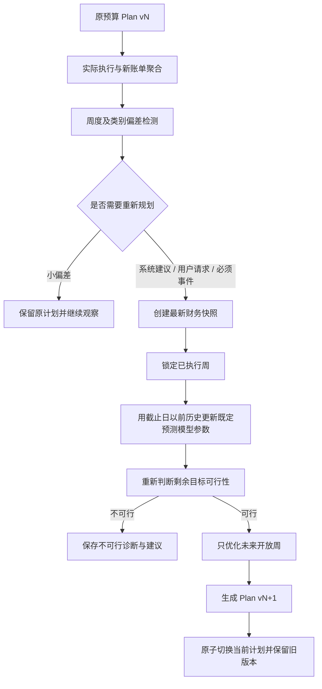

# 实际消费反馈与滚动预算再规划

## 1. 为什么需要滚动规划

阶段 6 的预测和阶段 7 的预算都是基于生成时可用信息的计划。真实消费、收入、目标和最低预算会变化，因此预算不能一次生成后固定不动。阶段 8 的原则是：历史事实不可改，未来计划可重算；事件是审计依据，最新财务快照才是资金事实。



## 2. 偏差检测与触发机制

每周比较实际净消费与原计划：

```text
absolute_variance = actual - planned
percentage_variance = absolute_variance / planned
```

同时计算每个类别的金额偏差和比例偏差。V1 默认“系统建议”阈值为：超支至少 100 元且超过该周预算 20%。100 元是阶段 5 单笔消费 95% 分位数 73.99 元向上取整后的保守建议值；20% 是可解释的执行容忍带，不是统计定律。二者都可由用户修改，也可切换为满足任一条件。

小偏差只记录，不自动重算。以下触发来源分开保存：

- `SYSTEM_SUGGESTED`：达到用户配置的偏差阈值；
- `USER_REQUESTED`：用户可在任何时候主动要求；
- `EVENT_REQUIRED`：计划外支出、额外收入、未来收入改变、目标或约束改变。

计划外大额支出是明确事件；普通预算超支只有达到规则或用户主动选择时才建议再规划。

## 3. 财务事件

系统支持 `PLANNED_OVERRUN`、`UNPLANNED_EXPENSE`、`EXTRA_INCOME`、`INCOME_DECREASE`、`INCOME_INCREASE`、`GOAL_AMOUNT_CHANGE`、`GOAL_DATE_CHANGE`、`BUDGET_CONSTRAINT_CHANGE` 和 `MANUAL_REPLAN`。

事件金额不能直接当作未来预算调整额。已发生的支出或收入应先反映到最新快照；未来收入变化进入新版收入假设；目标和约束变化进入其新版本。算法不会再次把事件金额加减一次，从而避免重复记账。数据库使用事件去重键，并允许多个事件共同关联一个新计划。

## 4. 最新财务快照与剩余目标

每次再规划先建立 `financial_snapshot`，记录再规划时真实可用存款。新计划引用新快照，旧计划继续引用旧快照。

```text
remaining_required_savings = max(0, target_savings - current_savings)
```

若当前存款已经达到目标，返回 `GOAL_ACHIEVED`，停止继续压缩预算，并可将目标和计划链标记完成。否则用当前存款、未来收入和未来最低预算重新执行阶段 7 可行性判断。不可行时返回 `REPLAN_INFEASIBLE`，不产生假预算。

## 5. 锁定周、进行中周与开放周

- `ACTUALIZED/LOCKED`：`next_open_week` 之前，实际消费和原预算不可修改；
- `IN_PROGRESS`：尚未形成完整周时只展示累计偏差，默认不作为完整周模型训练样本；
- `OPEN`：从 `next_open_week` 起，可作为优化变量。

状态由日期、完整性和再规划截止点计算，不额外建立周状态表。新计划只保存开放周明细；历史周通过父计划和真实交易聚合追溯。

## 6. 预测更新与防泄漏

滚动更新继续使用阶段 6 已选模型类型：总消费历史扩展均值、餐饮和购物历史中位数。只加入截止周及以前的完整周，重新估计均值或中位数；其他类别按最新历史均值结构与总量守恒对齐。任何等于或晚于首个开放周的真实消费都会触发 `future_actual_leakage`。

每周更新参数不等于重新选模型。累计新增 8 个完整周后仅标记“建议重新运行完整模型比较”，阶段 8 不自动切换模型。

## 7. 再规划与恢复周期

先计算不重新规划的对照结果：

```text
no_replan_final = current_savings + remaining_income - old_future_budget
recovery_gap = max(0, target_savings - no_replan_final)
```

这一定义会自动考虑原计划余量、额外收入和目标变化，因此突发事件金额不必等于预算削减金额。

用户可以把恢复周期设为 2 周、4 周或全部剩余周期。恢复周期形成一个累计预算硬约束：截至恢复周的新版累计预算，不得高于旧累计预算减 `recovery_gap`。阶段 7 的最低预算、固定预算、调整意愿、习惯偏离和平滑约束仍全部有效。若指定恢复期过短但整个期限仍可行，返回 `RECOVERY_HORIZON_INFEASIBLE`，提示选择更长周期，而不是突破最低预算。

默认周期随模式变化：TARGET_FIRST 最多 2 周，BALANCED 最多 4 周，LIFESTYLE_FIRST 使用全部剩余周期；用户明确选择时优先使用用户值。

## 8. 三种模式

- TARGET_FIRST：允许更快恢复并保留少量目标余量；
- BALANCED：默认分摊至中等恢复周期；
- LIFESTYLE_FIRST：将冲击扩散到更长周期，严格保护低调整意愿类别；若原期限不兼容则建议延长目标日期。

模式仍调用同一个阶段 7 优化器，但使用不同调整边界、权重、平滑系数和恢复周期。自动化测试验证三种模式对同一输入产生不同类别预算。

## 9. 计划版本和事务

计划使用不可变版本链：

```text
Plan v1 (ACTIVE)
  └─ Event A
     Plan v2 (ACTIVE, parent=v1; v1=SUPERSEDED)
       └─ Event B + Event C
          Plan v3 (ACTIVE, parent=v2; v2=SUPERSEDED)
```

`budget_plan_events` 支持一次重算关联多个事件。快照、事件、新计划、计划明细、事件关联和旧计划状态切换处于同一个 SQLite/SQLAlchemy 事务；任一步失败全部回滚。不可行尝试可以保存诊断，但不会取代仍可执行的当前计划。目标金额或日期变化创建新的 `saving_goal` 版本并指向旧目标，不覆盖历史。

数据库迁移 `0003_rolling_replan` 新增快照、目标、收入假设、预算约束、事件、计划、事件关联和计划明细表，并通过 `base -> head -> base -> head` 测试。

## 10. 新旧计划差异与风险

每次结果包含：

- 旧/新预计期末存款；
- 旧/新未来总预算及有符号差额；
- 平均每周预算变化；
- 每个类别的总调整；
- 最大类别调整；
- 旧/新风险等级；
- 旧/新目标日期；
- 最低预算违反次数。

风险仍是点预测、80%上界和最低支出情景的标签，不是成功概率。

## 11. 恢复指标

- `recovery_gap`：若保持旧未来预算，期末目标仍缺少的金额；
- `remaining_savings_gap`：目标金额减当前存款，最低为 0；
- `budget_adjustment_total`：新未来预算减旧未来预算，有符号；
- `average_weekly_adjustment`：总调整除以开放周数；
- `max_category_adjustment`：分类总调整绝对值最大值；
- `plan_deviation_score`：阶段 7 的归一化习惯偏离；
- `weeks_to_recover`：从首个开放周开始，累计“旧预算减新预算”首次达到 `recovery_gap` 的周数；若到期仍达不到则为 `null`。

`NO_REPLAN` 保持旧未来预算，仅更新当前快照和未来收入，用作阶段 10 的固定预算对照。

## 12. 脱敏聚合实验

实验沿用阶段 7 的真实数据聚合消费结构，模拟 12 周计划执行 3 周后发生事件，剩余 9 周开放。目标、收入、最低预算和冲击金额均为模拟值；未读取或提交逐笔交易。

| 事件 | 滚动结果 | 未来预算调整 | 预计期末存款 | 恢复周数 | 风险变化 |
|---|---|---:|---:|---:|---|
| 支出500元 | 可行 | -583.68元 | 12,583.68元 | 8 | HIGH→HIGH |
| 支出1000元 | 可行 | -1,108.71元 | 12,608.71元 | 9 | HIGH→HIGH |
| 支出3000元 | 不可行 | — | 最高12,065.63元 | — | HIGH→不可行 |
| 支出5000元 | 不可行 | — | 最高10,065.63元 | — | HIGH→不可行 |
| 额外收入500元 | 可行 | +466.29元 | 12,533.71元 | 0 | HIGH→HIGH |
| 额外收入2000元 | 可行 | +1,173.60元 | 13,326.40元 | 0 | HIGH→MEDIUM |
| 收入下降10% | 可行 | -1,108.71元 | 12,608.71元 | 9 | HIGH→HIGH |
| 收入下降30% | 不可行 | — | 最高12,065.63元 | — | HIGH→不可行 |

额外收入5000元的模拟快照已经超过目标，系统返回 `GOAL_ACHIEVED`，不生成“把未来预算设为0”的消费建议。

在1000元冲击下，NO_REPLAN 预计期末存款为11,500元，低于12,500元目标；滚动优化把未来预算降低1,108.71元，预计期末12,608.71元。多出的108.71元来自 TARGET_FIRST 的目标余量设计，不是把事件金额机械等同于预算调整。该比较只是基础验证，不声明统计显著性。

## 13. 局限性

1. 当前快照依赖用户确认或未来账户数据，微信账单不能推断完整资产余额。
2. 恢复周期是计划约束，不保证真实用户按预算执行。
3. 长期预测仍是历史基线延展，模型误差不会因再规划自动消失。
4. 默认阈值需要在阶段 9 暴露给用户，在阶段 10 做敏感性实验。
5. 当前没有复杂并发控制；单机 SQLite 事务适合本科项目和少量用户部署。

## 14. 阶段 10 实验接口

阶段 10 可在相同历史截止点、冲击和收入假设下比较 `NO_REPLAN` 与 `ROLLING_REPLAN`，使用目标缺口、最低预算违反、恢复周数、预算调整总额、最大类别冲击和习惯偏离作为指标。所有实验必须按时间前向模拟，禁止使用冲击发生后的未来真实消费。

可复现实验入口为 `scripts/run_replan_experiment.py`，聚合结果位于 `experiments/replanning/`。
